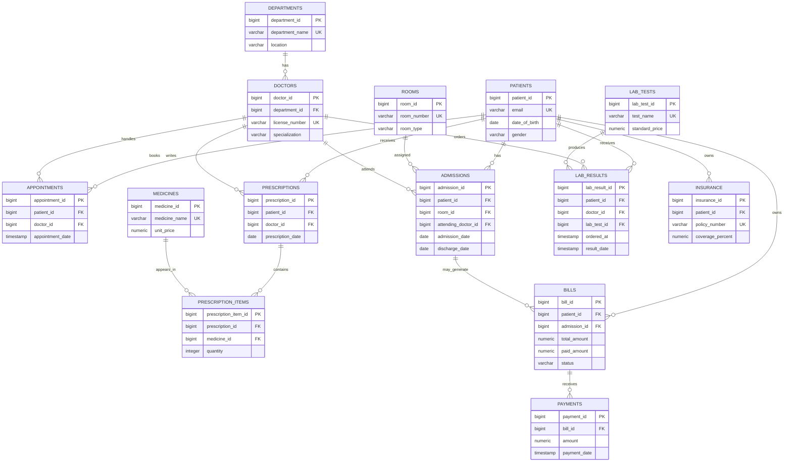

# ER Diagram

Copy the Mermaid block below into a Mermaid-enabled Markdown viewer.

## Relationship Notes

- A department has many doctors; each doctor belongs to one department.
- A patient can have many appointments; each appointment is handled by one doctor.
- Admissions optionally reference a room because a room assignment can change or be unavailable.
- Prescriptions and medicines form a many-to-many relationship through `prescription_items`.
- A bill can have multiple payments.
- A patient can have an insurance policy in this demo model; a production claims model would usually separate policy enrollment and claims.
